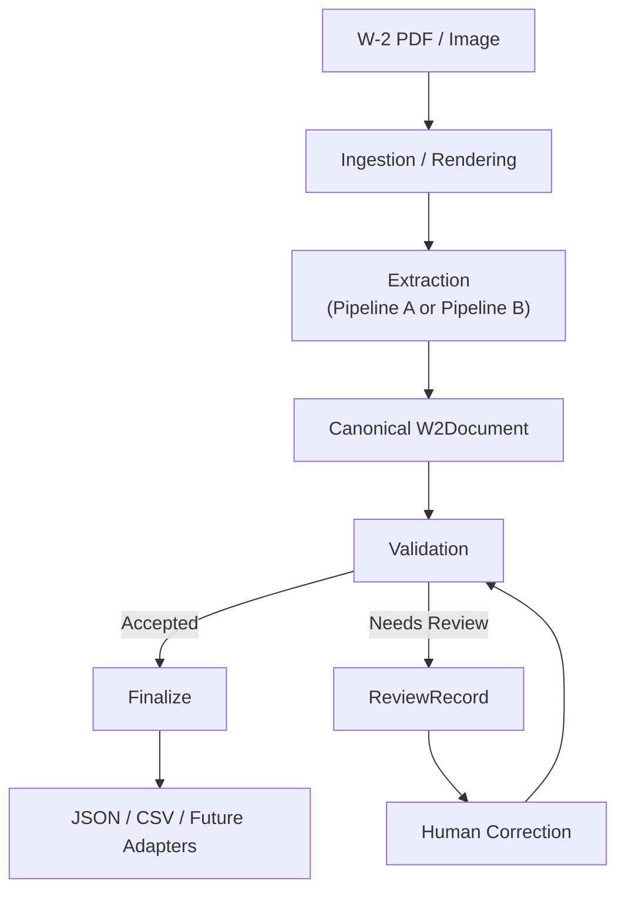

# Architecture Decision Record

This is the engineering narrative for the W-2 Pipeline project through
Phase 8C: what was built, what was tested, what the evidence shows, and
what was recommended for production at that point. It is written to be
readable by a technical decision-maker without reconstructing the
project from commit history. Deep evidence (raw benchmark artifacts,
full experiment narratives) lives in `docs/experiments/` and
`data/evaluation/results/`; this document cites it rather than repeating
it.

**This document is preserved as written** (with inline `~~strikethrough~~`
annotations where a later phase closed something it described as open).
Phases 8D.1-8D.3 extended the system after this document's Section 16
recommendation; for the **current** system boundary, decisions, metrics,
and limitations, see `docs/final-architecture.md`,
`docs/final-decisions.md`, `docs/final-evaluation-summary.md`, and
`docs/known-limitations.md`. This document remains the fuller narrative
of *how* the project arrived there.

## 1. Final System Architecture

```text
W-2 PDF / image
        |
        v
Ingestion + rendering              (Phase 2)
        |
        v
Extraction                         (Pipeline A or Pipeline B)
        |
        v
Canonical W2Document                (Phase 1)
        |
        v
Production validation               (Phase 6)
      /   \
     /     \
 accepted   needs_review
    |            |
    v            v
 Finalize    ReviewRecord            (Phase 7)
    |            |
    |            v
    |       Human correction
    |            |
    |            v
    |       Re-validation  --------> (loops back to Phase 6, same validator)
    |            |
    |         accepted
    |            |
    v            v
        JSON / CSV output            (Phase 7)
```



Under extraction:

```text
Pipeline A (selected as primary):
  pixels -> OCR -> deterministic parser -> targeted visual/layout
  fallbacks (e.g. Box 13 checkbox pixel detection, employer-name zone
  recovery) -> W2Document

Pipeline B (evaluated, not selected as primary):
  pixels -> Qwen3-VL-4B-Instruct -> structured JSON -> W2Document
```

Both converge on the identical canonical `W2Document` and the identical
Phase 6 validator; neither extraction pipeline nor the validator was
changed to accommodate this decision.

## 2. Extraction Architecture Decision

**Primary architecture family: OCR + deterministic parsing (Pipeline A).**
**Current leading backend: PaddleOCR, GPU.**
**Cost-optimized alternative: Tesseract, CPU.**
**Rejected as primary path (for this workload): Qwen3-VL-4B-Instruct (Pipeline B).**

This is a measured conclusion, not a preference. Section 3 gives the
evidence for each backend; Section 4 gives the evidence for the VLM
rejection; Section 6 explains why the decision is an economics question
as much as an accuracy one.

## 3. Pipeline A Results (Backend Comparison)

All figures below are field accuracy on the external Symage clean-render
benchmark set (150 independently generated 2026-style W-2 images) or its
derived degraded variants, from already-committed, unmodified result
artifacts. **Scope discipline**: the four variants (clean, compressed
JPEG, rotated, blurred) have not all been re-benchmarked together at
600-document scale since the most recent fixes landed -- see the
per-variant citations below, and do not read a single combined "600-doc"
number as reflecting every fix.

### PaddleOCR GPU (RTX 3060)

| Variant | Field accuracy | Source artifact |
|---|---:|---|
| Clean render (150 docs) | **100.0%** | `phase4e_paddleocr_gpu_checkbox_vision_external_clean_150.json` |
| Compressed JPEG (150 docs, within 600-doc run) | 100.0% | `phase4e_paddleocr_gpu_checkbox_vision_external_all_variants_600.json` |
| Blurred (150 docs, within 600-doc run) | 100.0% | same |
| Rotated (150 docs, within 600-doc run, *pre*-Box-e-fix) | 90.5% | same |
| Rotated (150 docs, dedicated rerun, *post*-Box-e-and-capital-E-fix) | **98.3%** | `phase4e_paddleocr_gpu_capital_e_fix_rotated_150.json` |
| Average latency, clean-150 | **1.44s/doc** | `phase4e_paddleocr_gpu_checkbox_vision_external_clean_150.json` |
| Average latency, 600-doc run | 1.33s/doc | `phase4e_paddleocr_gpu_checkbox_vision_external_all_variants_600.json` |

The rotated-variant number has two entries because the Box e
label-bleed/capital-E fixes (`docs/experiments/pipeline-a-extraction-history.md`)
landed after the 600-doc run; only a dedicated rotated-only rerun
confirmed the fix at scale. The remaining rotated-variant gap
(98.3%, not 100%) is fully attributable to one known, separate,
unresolved issue: **Box 13's pixel-based checkbox detector does not track
geometry shifts under rotation** (`retirement_plan` field accuracy drops
to 60.0% specifically under rotation, on both OCR backends identically --
`docs/contracts/extraction-pipeline-a.md`'s "Box 13 Visual Checkbox
Detection"). This is a distinct, already-documented, backend-neutral
limitation, not a new one; it is the single largest remaining error
source in this backend's rotated-variant number.

Distinguishing **OCR-component accuracy** from **end-to-end Pipeline A
accuracy**: every number above is the full end-to-end pipeline (OCR ->
deterministic parser -> canonical document), matching how this project
has always measured Pipeline A. There is no separate "OCR-only" accuracy
metric collected in this project (OCR text quality was never scored in
isolation from the parser that consumes it).

### Tesseract (CPU, PSM 3 + supplemental PSM 6 -- current incumbent default)

| Variant | Field accuracy | Source artifact |
|---|---:|---|
| Clean render (150 docs) | 99.3% | `phase4e_tesseract_checkbox_vision_external_clean_150.json` |
| Compressed JPEG (150 docs, within 600-doc run) | 99.0% | `phase4e_tesseract_checkbox_vision_external_all_variants_600.json` |
| Blurred (150 docs, within 600-doc run) | 67.7% | same |
| Rotated (150 docs, within 600-doc run, *pre*-Box-e-fix) | 90.0% | same |
| Rotated (150 docs, dedicated rerun, *post*-Box-e-and-capital-E-fix) | **97.5%** | `phase4e_tesseract_capital_e_fix_rotated_150.json` |
| Average latency, clean-150 | **2.33s/doc** | `phase4e_tesseract_checkbox_vision_external_clean_150.json` |
| Average latency, 600-doc run | 2.32s/doc | `phase4e_tesseract_checkbox_vision_external_all_variants_600.json` |

Tesseract's remaining rotated-variant gap includes the same shared Box 13
rotation-geometry limitation above, plus its own residual, smaller,
independent weaknesses: accent-recognition misses (e.g. `"Jesús"` ->
`"Jesus"`) and occasional word-level detection gaps
(`docs/experiments/pipeline-a-extraction-history.md`). **Blur is
Tesseract's materially weakest condition (67.7%)** -- substantially worse
than PaddleOCR's 100.0% on the same condition. This is the clearest,
most decision-relevant robustness gap between the two backends.

**PSM 11 supplemental experiment** (`phase4e_tesseract_supplemental_psm11_external_clean_150.json`):
a targeted second OCR pass recovered a small accuracy gain on clean-render
documents -- 99.39% vs. the incumbent's 99.28% (+0.12 points, 4 fields
out of 3,450, zero regressions) -- at a **+51.98% latency cost** (2.33s ->
3.54s/document, every document, not just the ones that benefited).
**Rejected as an always-on configuration**: a real but narrow accuracy
gain does not justify a 52% latency tax on every single document.

### Summary Judgment: PaddleOCR vs. Tesseract

On every measured dimension -- clean-document accuracy, compressed-JPEG
accuracy, blur robustness, rotated accuracy (once both backends' fixes
are compared on equal footing), and latency -- **PaddleOCR GPU currently
leads Tesseract CPU**. The one dimension this document does not resolve
in Paddle's favor by default is **cost**: Paddle requires GPU
infrastructure; Tesseract does not. See Section 6.

## 4. Pipeline B (Qwen3-VL-4B-Instruct) Results

Source: `docs/experiments/phase5a-pipeline-b-feasibility.md`,
`data/evaluation/results/phase5a_pipeline_b_smoke_clean_4.json`,
`..._rotated_1.json`. This was an explicit feasibility spike: 5 documents
total (4 clean + 1 rotated), not a scaled benchmark.

| Metric | Value |
|---|---|
| Model | `Qwen/Qwen3-VL-4B-Instruct`, `device="auto"`/`dtype="auto"` |
| Hardware | NVIDIA RTX 3060 (12 GB VRAM); ~12 GB in use during generation -- narrow headroom |
| Document success rate | **4/5 (80%)** -- 1 document failed schema validation entirely |
| Conditional field accuracy (successful documents only) | **100%** (92/92 fields, every field type exact) |
| Average latency, clean | 58.4s/document |
| Average latency, rotated | 70.2s/document |
| Observed failure mode | Model wrote a Box 12 sub-row's printed line label (`"12a"`) instead of the actual 1-2 letter code, exceeding the canonical field's length limit |

**Conditional accuracy vs. end-to-end reliability -- these are two
different numbers and must not be collapsed into one.** "100% conditional
accuracy" describes performance *given that the model already produced a
valid, well-formed document* -- it says nothing about the 1-in-5 case
where it didn't. The correct single-number characterization of this
sample is: 4 of 5 documents produced a usable result, and of those 4,
every field was correct. Reporting only "100% accuracy" without the 80%
success-rate qualifier would misrepresent the experiment.

**Why Qwen3-VL-4B-Instruct is rejected as the primary architecture for
this workload:**

- **Latency**: 58-70s/document vs. PaddleOCR's 1.3-1.4s/document -- roughly
  40-50x slower.
- **Hardware footprint**: a 4B-parameter model needing ~12 GB of a
  dedicated GPU's VRAM with narrow headroom, vs. PaddleOCR's much lighter
  GPU footprint (OCR-scale detection/recognition models) or Tesseract's
  CPU-only operation.
- **Lower observed document-level reliability** in this small sample (80%
  vs. Pipeline A's 0% document-level failure rate across every historical
  150/600-document Pipeline A benchmark run).
- **No demonstrated output-quality advantage** sufficient to offset those
  costs: on the documents it did complete, its accuracy matches
  Pipeline A's already-excellent clean-document accuracy, not exceeds it.

**This conclusion is scoped to Qwen3-VL-4B-Instruct as the tested primary
architecture for this specific, highly-structured, fixed-layout document
type.** It is not a claim that vision-language models are universally
unsuitable for document extraction -- only that, for a fixed-format tax
form where a deterministic parser already performs very well, this
specific model does not currently clear the bar to replace it. A VLM
remains a plausible future research/fallback path for less-structured
documents or exception handling (Section 9's escalation cases) --
speculative, not evidenced, so not recommended as a build item now.

## 5. Production Economics

The question is not "which is most accurate" in isolation -- it is
**which architecture minimizes total cost while preserving the accuracy
and throughput the business needs**:

```text
Total expected cost per document =
    compute cost
    + expected human-review cost (documents routed to needs_review)
    + operational/infrastructure complexity
    + cost/risk of extraction errors that reach a customer
```

| Factor | Tesseract (CPU) | PaddleOCR (GPU) | Qwen3-VL (GPU, VLM) |
|---|---|---|---|
| Infrastructure | CPU only -- lowest deployment complexity and likely lowest infrastructure cost | Requires GPU capacity -- higher infrastructure cost than Tesseract | Requires a GPU with real headroom for a multi-GB model -- highest infrastructure cost of the three |
| Measured robustness | Weaker (67.7% on blur) | Stronger (100% on blur, compressed, clean) | Not measured at scale; small-sample document failure rate observed |
| Measured latency | 2.3s/doc | 1.3-1.4s/doc (faster *and* GPU-accelerated) | 58-70s/doc |
| Likely review-queue volume | Higher (more documents/fields need human correction) | Lower | Unknown at scale; unattractive regardless given latency |

Paddle's GPU requirement is a real, non-zero infrastructure cost Tesseract
does not have -- but Paddle is also *faster* than Tesseract on the same
GPU-equipped machine while being *more accurate*, which directly reduces
the other cost term (human review volume) that a firm would otherwise
pay for out of accountant/reviewer time. **This document does not invent
an exact dollars-per-document figure for either backend** -- no cloud
provider GPU pricing or reviewer hourly-cost figure has been benchmarked
in this project. Any specific $/document conclusion is a **directional**
engineering judgment, not a costed calculation, until that pricing study
is done (Section 9).

Qwen3-VL is unattractive as a primary path purely on the compute-cost
axis: a document that takes 40-50x longer to process, on more expensive
hardware, at no better accuracy than the already-cheaper alternative, is
a straightforward rejection regardless of exact provider pricing.

## 6. Throughput And Customer Value

The product's value is not "extract one W-2" -- it is **"let an
accounting firm's staff process a stack of client W-2s fast enough that
their time goes to the parts of the job a computer can't do."**

```text
higher throughput / lower error rate
    -> less staff time spent on repetitive data entry and correction
    -> more client capacity during tax season (the firm's busiest, most
       time-constrained period)
    -> staff time shifts toward higher-value advisory, review, and
       client-facing work instead of transcription
```

This is why the 1.3s vs. 2.3s vs. 60s per-document latency numbers in
Section 3-4 are not just a technical curiosity: at firm scale (hundreds
or thousands of W-2s per season), the gap between "sub-2-second" and
"nearly a minute" per document is the difference between an assistive
tool and a bottleneck. The same logic applies to the false-review rate
measured in Section 8 below: a validator that never wastes a reviewer's
time on a document that didn't need it (0.0% false-review rate measured
in both analyzed conditions) protects that same staff capacity.

## 7. Production Validation Without Ground Truth

A critical distinction this project holds throughout, restated plainly
here:

```text
BENCHMARK ENVIRONMENT (testing)
document -> extraction -> prediction -> compare against KNOWN ground truth -> accuracy

PRODUCTION ENVIRONMENT (real customer documents)
customer document -> extraction -> canonical W2Document
    -> deterministic validation / quality signals (no ground truth exists)
    -> accepted OR needs_review
```

Production has no answer key. Phase 6's validator
(`docs/contracts/validation-and-routing.md`) therefore checks only what
is checkable *without* one: required fields present, SSN/EIN format,
supported tax year/schema, monetary sign/precision, and a small set of
structural sanity checks (Box 12 code shape, no entirely-empty
state/local rows). **It does not, and structurally cannot, prove that
every accepted value is correct.** A concrete, real example: `123-45-6789`
and `123-45-9876` are both valid-*looking* SSNs; if OCR or a model
confidently reads the wrong one, format validation has no way to know.
This limitation is stated plainly, not glossed over, and is exactly what
Section 8's measurement quantifies.

## 8. Validation Effectiveness (Measured, Not Assumed)

Full method and results: `docs/experiments/phase8-validator-effectiveness.md`;
raw artifacts: `data/evaluation/results/phase8_validator_effectiveness_rotated_150.json`,
`..._blurred_150.json`. Ground truth was used only to *score* the
validator's decision after the fact, never as an input to validation
itself (structurally enforced and tested).

| Condition | Erroneous docs | Error-detection recall | False-review rate | Auto-acceptance rate |
|---|---:|---:|---:|---:|
| Rotated (subtle, plausible-value errors: checkbox flips, accent misreads) | 76/150 | **9.2%** | **0.0%** | 95.3% |
| Blurred (severe corruption: missing/garbled SSN, EIN, money) | 109/150 | **88.1%** | **0.0%** | 36.0% |

**Reading this correctly**: the validator has a **0% false-review rate**
in both measured conditions -- it never sends a correctly-extracted
document to review. Its ability to *catch* real errors is highly
dependent on error type: it catches the large majority of severe,
structurally-detectable corruption (missing/malformed critical fields)
but has limited power against plausible-looking value swaps, exactly the
Section 7 limitation, now measured rather than asserted. Both numbers
required adjusting for one already-known confound: Symage ground truth's
universal `employer.name = null` gap (Section 10) would otherwise make
every document look "erroneous" from the validator's perspective and
collapse both analyses to a meaningless 0% acceptance rate -- the
experiment doc shows both the raw and adjusted numbers so this is
visible, not hidden.

## 9. Outstanding Decision: Paddle vs. Tesseract Economics

**Based on current performance evidence, PaddleOCR GPU is the preferred
backend** -- it wins on accuracy, robustness, and latency simultaneously
(Section 3). **Based on cost evidence, this is not yet a closed
question**: no actual cloud GPU pricing or reviewer labor-cost figure has
been benchmarked against Tesseract's CPU-only deployment cost. The
concrete follow-up study, not performed here:

```text
Paddle's incremental GPU infrastructure cost per 1,000 documents
    vs.
Tesseract's incremental human-review cost per 1,000 documents
    (expected review-queue minutes x accountant/reviewer hourly cost,
    using the higher error/review rate Tesseract's weaker robustness
    implies)
```

This document deliberately does not invent an answer to that
comparison. It states the direction (Paddle wins on measured performance)
and names exactly what a provider-specific deployment study would need
to establish before a final production commitment.

## 10. The Employer-Name Benchmark Blind Spot (Engineering Lesson)

Documented in full in `docs/experiments/phase6b-employer-name-investigation.md`
and `docs/experiments/phase6-validation-feasibility.md`. Restated here
because it is the clearest illustration in this whole project of *why*
production validation matters:

1. The Symage external benchmark adapter never mapped `employer.name`
   from its FUNSD annotations into `evaluated_field_paths`.
2. Consequently, **no benchmark accuracy number ever computed in this
   project could have revealed that Pipeline A was returning
   `employer.name = null`** on every external document -- the field was
   structurally invisible to every accuracy metric reported.
3. Phase 6 production validation, which does not depend on
   `evaluated_field_paths` at all, caught it on the very first real
   document it was pointed at.
4. Investigation (Phase 6B) showed OCR had read the employer's name
   correctly the entire time; the shared deterministic parser simply had
   no code path to recover it from the OCR layout (unlike the equivalent
   employee-name recovery path, which existed). A backend-neutral fix
   was implemented and verified.

**The lesson: a benchmark's accuracy number is only as complete as the
fields it scores.** A field excluded from scoring is a field a benchmark
cannot protect against regressing -- silently -- no matter how high the
reported overall accuracy looks. Production validation is a second,
independent safety net that does not share this blind spot, precisely
because it does not use the benchmark's scoring scope at all.

## 11. Known Evaluation Coverage Limitation -- Since Addressed (Phase 8A)

At the time this document was first written, `employer.name` was not in
the Symage adapter's `evaluated_field_paths`, even though a deterministic,
prediction-free mapping was known to exist (Phase 6B). **Phase 8A has
since implemented that mapping** (`docs/experiments/phase8a-final-benchmark-coverage.md`):
the Symage adapter now maps the first line of Box c's combined FUNSD
answer to `employer.name`, verified against 5 real documents with an
independently-parsed cross-check, with zero fabrication when the answer
is missing. `employer.address` remains unmapped -- its own extraction gap
is still unresolved and was explicitly kept out of this task's scope.

This is a version change, not a silent rewrite of history: the adapter's
`EXTERNAL_ADAPTER_VERSION` was bumped
(`"symage-w2.phase3b.v1"` -> `"symage-w2.phase8a.v2"`), so datasets
prepared before and after are structurally distinguishable, and **every
historical benchmark figure cited in Section 3 of this document still
correctly describes a run that excluded `employer.name`** -- none of
those numbers were recomputed or altered. The final Phase 8B benchmark
(not yet run -- see `docs/experiments/phase8a-final-benchmark-coverage.md`
for the exact commands) will be the first to measure `employer.name`
accuracy at scale, using the frozen 24-field final evaluated set.

## 12. Human Review Architecture (Summary)

Full contract: `docs/contracts/review-and-downstream-output.md`. In brief:

```text
needs_review -> ReviewRecord -> explicit human correction (by field path)
    -> corrected W2Document -> same Phase 6 validator -> resolved only
    when accepted -> downstream output
```

Properties worth restating: the original extraction is never mutated;
corrections are append-only and individually audited (field, old value,
new value, optional reason/reviewer); both the pre-review and
post-correction validation results are preserved side by side; there is
no AI auto-correction anywhere in this workflow -- every corrected value
is human-supplied; review records are persisted one-per-file, named only
by an opaque review ID (never a document ID, name, SSN, or EIN).

## 13. Downstream Output (Summary)

```text
FinalizedW2 -> export_json() / export_csv() -> (future: database / REST
API / webhook / tax-prep or accounting-platform adapter, none implemented)
```

Only a document with an `accepted` validation result -- whether
immediately, or after a review resolves -- can ever be finalized. No
vendor-specific integration (QuickBooks or otherwise) exists in this
project; the adapter boundary is deliberately generic so one could be
added later without touching extraction, validation, or review code.

## 14. Security / PII

**Implemented in this project:**

- Validation-issue values: SSN/EIN masked to last 4 digits; names and
  address lines fully redacted before appearing in any issue.
- Review record filenames: opaque review ID only, never a document ID,
  name, SSN, or EIN.
- PII-bearing local directories (`data/documents/`, `data/review/`) are
  gitignored by policy, with `README.md` files documenting why.
- Production validation and the review/downstream workflow never import
  or depend on benchmark ground truth or dataset annotations (enforced
  structurally by AST-based import tests throughout the codebase).

**Not implemented -- explicit production follow-ups, not oversights:**

- Encryption at rest and TLS in transit for stored documents/records.
- Authentication, authorization, and role-based access control.
- Multi-tenant data isolation.
- Durable audit logging beyond the review-correction audit trail already
  built.
- A data retention/deletion policy.
- Secrets management for any future external integration credentials.
- A managed database or object-storage backend (current persistence is
  local filesystem only, by design, for this phase).

## 15. Known Limitations (Full List)

- ~~Box 13's pixel-based checkbox detector does not track geometry shifts
  under rotation (60% accuracy on `retirement_plan` under rotation,
  identical on both OCR backends) -- the single largest remaining
  Pipeline A accuracy gap.~~ **Resolved (Phase 8C.10/8C.11).** The
  fixed-page-zone detector this described is no longer the default: an
  OCR-anchor-relative detector (`extraction/checkbox_anchor.py`) that
  locates the checkbox relative to the printed "Retirement plan" label's
  own OCR geometry replaced it as `ObservationAcquirer`'s default,
  reaching 600/600 (100%) on `box_13.retirement_plan` across all four
  600-document variants including `rotated_png`, with zero non-checkbox
  regressions. See
  `docs/experiments/phase8c10-anchor-relative-checkbox-detector.md` and
  `docs/experiments/phase8c11-anchor-checkbox-promotion.md`.
- Tesseract has residual accent-recognition and blur-robustness
  weaknesses beyond what PaddleOCR shows on the same documents.
- ~~`employer.address` has the identical OCR-layout-fallback gap
  `employer.name` had before Phase 6B's fix -- not yet remediated.~~
  **Resolved (Phase 8D.1A/8D.1B).** `employer.address`/`employee.address`
  got the same OCR-layout-fallback treatment `employer.name` did, plus a
  dedicated evidence-based validator rule (`address_extraction_evidence`)
  closing unsafe acceptance on this field family from 2.17% to 0.33%
  overall (7.33% to 0.0% on `rotated_png`). See
  `docs/experiments/phase8d1a-annotation-coverage-and-full-field-remediation.md`,
  `docs/experiments/phase8d1b-address-safety-and-box12-slot-semantics.md`.
- ~~The Symage benchmark's field coverage (`evaluated_field_paths`) still
  excludes `employer.address` (`employer.name` was added in Phase 8A --
  Section 11), so benchmark accuracy numbers cannot yet reflect quality
  on `employer.address`, and no benchmark has yet been rerun to measure
  `employer.name` at scale under the new coverage (Phase 8B, not yet run).~~
  **Resolved (Phase 8D.1A).** The ground-truth adapter now maps
  employer/employee address, Box 12, and state/local values (previously
  present in source annotations but never scored); the expanded
  600-document benchmark reached 99.649% overall field accuracy across
  the wider field set. See `docs/final-evaluation-summary.md`.
- Deterministic validation cannot detect a plausible-but-wrong value
  that passes format checks (measured directly in Section 8: 9.2%
  recall on subtle value-swap errors at that phase). **Narrowed, not
  fully closed (Phase 8D.1B)**: the evidence-based rules added since
  raised overall error-detection recall to 88.2% (100% on
  `rotated_png`) by distinguishing *incomplete* extraction from a
  *wrong-but-complete* one; 2 of 600 documents still slip through as a
  plausible-looking OCR character misread, honestly reported in
  `docs/known-limitations.md` rather than absorbed into this number.
- Review-record persistence is filesystem-only; no reopen workflow for a
  resolved review.
- No authentication or multi-tenancy anywhere in the system.
- The Pipeline B (VLM) evaluation is a 5-document feasibility spike, not
  a statistically meaningful sample -- its numbers should not be
  extrapolated to a claim about accuracy or reliability at scale.
- No production cost figure has been benchmarked against a real cloud
  workload; Section 5's economics discussion is directional.

None of the above invalidate the system: each has either a known
mitigation path, a documented next step, or is explicitly out of this
take-home's intended scope.

## 16. Final Recommended Production Architecture

```text
PRIMARY:
  PaddleOCR (GPU) -> deterministic W-2 parser -> targeted visual/layout
  fallbacks -> canonical W2Document -> Phase 6 validation -> accept/review
  -> Phase 7 downstream output

ALTERNATIVE (cost-constrained deployments):
  Tesseract (CPU), where GPU infrastructure cost is a harder constraint
  than the higher measured review/error rate it implies -- see Section 9's
  outstanding economics study before committing to this as a permanent
  choice for a specific deployment.

VLM (Qwen3-VL or similar):
  Not primary. A plausible future research direction for less-structured
  document types or as an escalation path for documents Pipeline A
  cannot confidently parse at all -- not evidenced or scoped here, listed
  only as a direction, not a recommendation to build next.
```

No hybrid VLM-fallback architecture is recommended at this time: nothing
in the evidence collected shows Pipeline A failing in a way a VLM
fallback would meaningfully rescue (Pipeline A's document-level failure
rate across every historical benchmark is 0%), so adding that complexity
now would be speculative, not evidence-driven.
