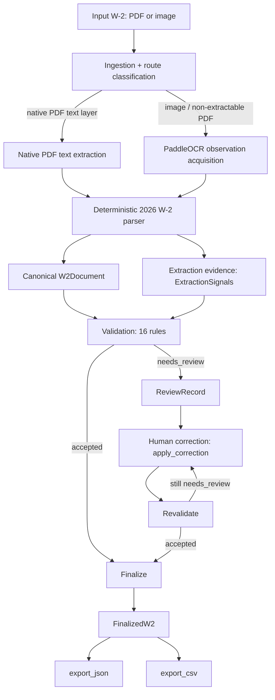

# Final Architecture (Phase 8D.3)

The production architecture as it stands at the Phase 8D.3 freeze. This
document describes **current production behavior only** -- historical
experiments, rejected alternatives, and the full evidence trail live in
`docs/experiments/*.md` and `docs/architecture-decision-record.md`, and
are preserved there rather than repeated here. See
`docs/final-decisions.md` for *why* each choice below was made.

## System boundary

```text
INPUT:  one completed individual W-2 document (PDF or image)

SYSTEM: ingestion -> acquisition routing -> OCR/native extraction ->
        deterministic parsing -> canonical W2Document -> validation/
        evidence checks -> accepted OR needs_review -> human correction
        if needed -> revalidation -> finalization -> JSON/CSV downstream
        output

OUTPUT: validated canonical W-2 data ready for downstream
        tax-preparation systems
```

**Explicitly out of scope** -- not built, not partially built, not
planned within this project:

- Employer payroll / W-2 *generation* (this system only reads W-2s, never creates them)
- Tax calculation of any kind
- Form 1040 or any other tax-return preparation
- IRS e-file / filing transmission
- A production GUI (a CLI operator interface exists; see below)
- A broad, multi-document-type platform -- this system targets the 2026 W-2 specifically

## Component flow



This mirrors `docs/contracts/review-and-downstream-output.md`'s original
diagram; nothing about the shape of this flow changed since Phase 7 --
Phases 8A-8D added evidence signals, promoted detectors, and closed
safety gaps *within* this same flow.

## Ingestion

`src/w2_pipeline/ingestion/` (`IngestionService.ingest` /
`ingest_document`). Accepts a local PDF, JPEG, or PNG file; validates it
is readable and matches its declared type (extension + file-magic
cross-check); computes a SHA-256 for provenance; classifies whether a
PDF has a native, directly-extractable text layer or must go through
OCR. Ingestion answers *what was received*, not *what W-2 fields are
present* -- it never populates `W2Document`.

## Observation acquisition

`src/w2_pipeline/extraction/acquisition.py` (`ObservationAcquirer`).
Produces a route-tagged, backend-neutral set of text observations
(text + bounding-box geometry, plus native OCR confidence where the
backend provides it -- never used as a validation input; see
`docs/final-decisions.md` #7).

- **`AcquisitionRoute.NATIVE_PDF`** -- PDF's own text layer, no OCR.
- **`AcquisitionRoute.OCR`** -- full-page OCR (PaddleOCR is the
  production-selected backend; Tesseract remains a documented
  cost-optimized CPU alternative, both selectable via
  `run_pipeline_a.py --ocr-backend`).
- **`AcquisitionRoute.MIXED`** -- a PDF with a partial/unreliable native
  text layer, supplemented by OCR.
- Pipeline B (the rejected-as-primary VLM architecture,
  `src/w2_pipeline/extraction/pipeline_b/`) reports its own
  `route="vlm"` string -- not a member of `AcquisitionRoute`, since it
  is a categorically different extraction mechanism with no OCR
  observations at all.

`enable_anchor_relative_checkbox` defaults to `True` (Phase 8C.11) --
Box 13's checkbox detector runs the anchor-relative CV path by default;
the older fixed-zone detector remains available only as an explicit
opt-out, not the default.

## Extraction

`src/w2_pipeline/extraction/parser_2026.py` + `pipeline_a.py`
(`PipelineAExtractor`). Deterministic, rule-based -- no ML model in this
path except the OCR text detector/recognizer itself and the Box 13
checkbox CV detector.

- Federal boxes 1-6, employee/employer identity: direct zone- and
  label-anchored parsing.
- **Address extraction** (`employer.address`/`employee.address`):
  zone-based row parsing with a dedicated OCR layout fallback per party
  (`_apply_ocr_employer_layout_fallbacks`/`_apply_ocr_employee_layout_fallbacks`);
  also produces `AddressExtractionEvidence` (region observation count,
  usable row count, `parse_complete`) alongside the parsed value.
- **Box 12**: parsed as semantic `{code, amount}` entries per the
  confirmed IRS coded-item contract (`docs/final-decisions.md` #11) --
  a blank-code placeholder slot is never emitted as a canonical entry.
- **Box 13 (`retirement_plan`)**: `checkbox_anchor.py`'s
  anchor-relative pixel/CV detector (default since Phase 8C.11), which
  locates the checkbox relative to its printed label using true image
  pixel dimensions (the one place in this codebase that uses raw image
  size rather than OCR-layout-extent-relative zones) rather than a
  fixed page-global ratio zone, and produces `Box13CheckboxEvidence`
  (detection method, anchor/checkbox found, shape score, ink ratio,
  decision margin) alongside the boolean. The older fixed-zone detector
  (`checkbox_vision.py`, Phase 4E) remains available only as an
  explicit opt-out (`enable_anchor_relative_checkbox=False`), not the
  default.
- **State/local rows**: zone-based parsing mirroring the federal-box
  mechanism, covering Boxes 15-17 (18-20 implemented, unverified --
  see `docs/final-evaluation-summary.md`'s field coverage table).

Every parser output that has a dedicated evidence signal
(`ExtractionResult.employer_address_evidence`,
`employee_address_evidence`, `box_13_checkbox_evidence`,
`box_12_amount_without_code_found`, `employer_name_observation_count`)
carries that evidence forward as *primitives* into `ExtractionSignals`,
never a single collapsed confidence number.

## Canonical contract

`src/w2_pipeline/contracts/w2.py` -- `W2Document`, `extra="forbid"`
throughout. Nested `Address`, `Box12Entry`, `StateLocalEntry` models;
money fields are exact-precision strings, never floats; `Box12Entry`
and `StateLocalEntry` are repeated structures (lists), matching the
form's own repeated-slot layout. `metadata` carries document
identity/provenance (document ID, source filename/type, schema
version) -- separate from business-content fields.

**Canonical values vs. extraction evidence are two different objects**:
`W2Document` never carries evidence fields itself; `ExtractionResult`
(extraction-side) and `ExtractionSignals` (validation-side, primitives
only) carry evidence alongside the document, never inside it. This
keeps the canonical schema a pure "what does the W-2 say" contract.

## Validation

`src/w2_pipeline/validation/validator.py` (`validate_w2_document`), 16
rules (`ALL_RULE_NAMES`). Backend-neutral by construction -- this
package imports only `w2_pipeline.contracts` and its own sibling
modules, never `w2_pipeline.extraction` or `w2_pipeline.evaluation`
(enforced by `tests/validation/test_isolation.py`'s AST-based import
check), so Pipeline A and Pipeline B call the identical validator on
their own canonical output.

Layered model:

1. **Structural/schema checks** -- required fields present
   (`employee_identity_required_fields`, `employer_identity_required_fields`,
   `core_wage_tax_fields_required`), supported metadata/tax year.
2. **Domain-format checks** -- `ssn_format`, `ein_format`,
   `address_format`, `box_12_code_format`, `monetary_fields_valid`.
3. **Consistency checks** -- `no_empty_state_local_entries`,
   `box_12_amount_without_code` (a nonzero amount with no code is
   anomalous, routes to review rather than being silently dropped).
4. **Extraction-evidence checks** -- `retirement_plan_checkbox_evidence`,
   `address_extraction_evidence`, `employer_name_address_leak`,
   `employer_name_layout_anomaly`. These are the rules built specifically
   because a value can be *structurally valid and still wrong* (a
   boolean is valid whether or not the checkbox was read correctly).
   Each is **route-scoped** by positive allow-list --
   `signals.route in ("ocr", "mixed")` -- exempting `native_pdf`
   (different mechanism, no OCR evidence to check) and Pipeline B's
   `route="vlm"` (a different pipeline entirely), rather than
   default-denying every route.
5. **Review routing** (`routing.py`, `decide_status`) -- any
   `ERROR`-severity issue forces `needs_review`; the default policy does
   not escalate `WARNING`-severity issues.

**Confidence is explicitly not one combined probability.** Five
distinct kinds of signal exist side by side, never merged:

- OCR recognition confidence (native per-engine, never used as a
  decision input -- Phase 8C.4)
- Parser/layout evidence (`employer_name_observation_count`, row/zone
  match quality)
- Checkbox visual evidence (`Box13CheckboxEvidence`'s shape
  score/ink ratio/decision margin)
- Address structural evidence (`AddressExtractionEvidence`'s region
  observation count / usable row count / `parse_complete`)
- Semantic plausibility (format/domain checks -- SSN pattern, EIN
  pattern, monetary sign/precision)

## Human review

`src/w2_pipeline/review/` (`start_review`, `apply_correction`,
`revalidate`; `FileReviewRepository`). A `needs_review` document gets a
durable `ReviewRecord` (`pending` -> `in_review` -> `resolved`),
persisted as one JSON file per review ID (never a name/SSN/EIN in the
filename). Every issue carries a `code`, `severity`, and `field_path`.
Corrections are explicit human-supplied `(field_path, new_value)` pairs
applied via a fully generic dotted/indexed path traversal
(`field_paths.py` -- no field allowlist; any path that resolves against
`W2Document`'s own structure works, verified down to
`box_12_entries[0].code`-style indexed paths). A correction is
`resolved` only once `revalidate` re-runs the *same* validator and it
returns `accepted`. No AI auto-correction exists anywhere in this
workflow.

**Finalization gating**: `finalize_document` raises `NotAcceptedError`
for any non-`accepted` status -- proven blocked-then-unblocked
end-to-end in Phase 8D.2 (`docs/operator-walkthrough.md`).

## Downstream

`src/w2_pipeline/downstream/` -- `FinalizedW2` (`status: Literal["accepted"]`,
a type-level invariant, not just a runtime check -- tightened in Phase
8D.1 to close a construction-time bypass), `export_json`, `export_csv`.
**No unresolved (`needs_review`) document can become downstream output**
under any code path in this package. Both exports are deterministic --
byte-identical output for byte-identical input, verified in Phase 8D.1
and re-verified in Phase 8D.2. Repeated structures (`box_12_entries`,
`state_local_entries`) encode as nested JSON arrays in `export_json` and
as a JSON-encoded string cell per row in `export_csv` (CSV has no native
nested-array representation). The adapter boundary
(`downstream/adapter.py`) is deliberately generic -- a future database,
REST API, webhook, or accounting-platform adapter only needs to accept a
`FinalizedW2`, never touching extraction/validation/review code.

## Operator interface

`src/w2_pipeline/review/cli.py` -- `validate`, `review-create`,
`review-correct`, `review-revalidate`, `export-document`, `export-review`.
As of Phase 8D.2, `validate`/`review-create`/`export-document` accept an
optional `--signals-json <path>` (a full `ExtractionSignals` JSON
document) so a real OCR-route extraction's checkbox/address evidence can
reach the validator through the CLI, not only `--pipeline-id`/`--route`.
See `docs/operator-walkthrough.md` for the full command sequence.

## Post-freeze operator/demo layer (Phase 8D.4-8D.7 addendum)

Everything above this section is the frozen Phase 8D.3 snapshot,
preserved as written. Phases 8D.4-8D.7 subsequently closed the
single-document-extraction-CLI gap this section used to describe and
added three more ways to drive the same, otherwise-unchanged
extraction/validation/review/export flow -- none of them changed any
extraction, validation, or export behavior described above:

- **Phase 8D.4**: `python -m w2_pipeline.cli.run_document <file>`
  (`w2_pipeline.application.run_document.run_document()`) -- the
  canonical single-document entry point. See
  `docs/single-document-runner.md`.
- **Phase 8D.5**: `python -m w2_pipeline.cli.run_batch <files...>`
  (`w2_pipeline.application.run_batch.run_batch()`) -- runs many
  documents through one warmed-once Pipeline A extractor, plus
  explicit `model_startup_seconds`/`processing_latency_seconds`/
  `total_duration_seconds` timing semantics both CLIs now share. See
  `docs/batch-runner.md`.
- **Phase 8D.6**: `skills/run-w2-pipeline/SKILL.md` -- a thin agent
  skill so Claude Code/Codex can drive both CLIs using their
  machine-readable `run_summary.json`/`batch_summary.json` output.
- **Phase 8D.7**: a local demo UI -- a thin FastAPI transport layer
  (`w2_pipeline.api`) over the same `run_document()`/`run_batch()`
  calls, with a Next.js/TypeScript frontend. See `docs/demo-ui.md`.

```text
                        +--------------------+
                        | Next.js/TypeScript |
                        | Operator UI        |
                        +---------+----------+
                                  | HTTP
                                  v
                        +--------------------+
                        | FastAPI / Python   |
                        | Thin API Layer     |
                        +---------+----------+
                                  |
                     +------------+------------+
                     v                         v
              run_document()              run_batch()
                     |                         |
                     +------------+------------+
                                  v
                         Pipeline A / Paddle
                                  v
                         Canonical Extraction
                                  v
                            Validation
                       +----------+----------+
                       v                     v
                  Accepted             Needs Review
                       |                     |
                  Finalize              ReviewRecord
                       |
                  JSON / CSV
```

The Next.js UI is presentation only; FastAPI is transport/API only.
Neither contains extraction, validation, review-decision, finalization,
or CSV-flattening logic -- both are thin adapters over the exact same
`run_document()`/`run_batch()` application services the CLIs and the
agent skill call, so the backend documented above remains fully usable
(and independently correct) with no UI running at all.
